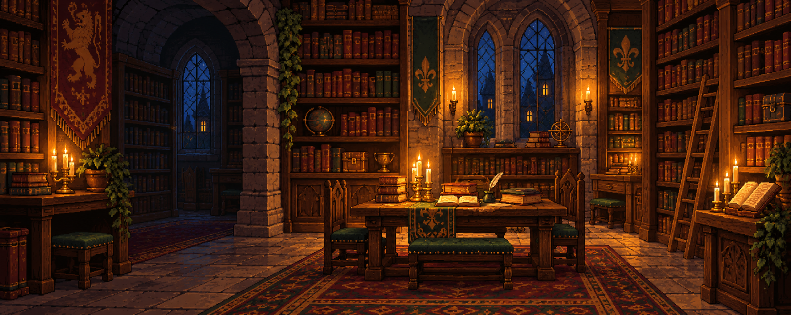
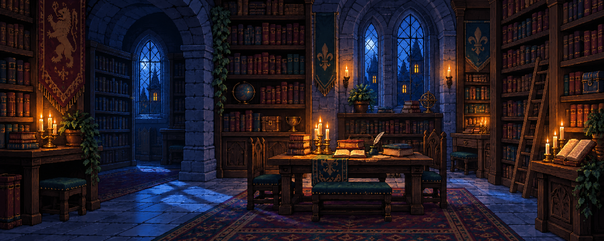

# Prévias visuais — Biblioteca Medieval

A interface usa a mesma composição de biblioteca em duas atmosferas de iluminação. A versão acolhedora trabalha a luz de velas; a versão noturna usa luz azul. As páginas completas e interativas estão publicadas no GitHub Pages:

- [Abrir o mockup acolhedor](https://leftson13.github.io/biblioteca-medieval/identidade/index.html?tema=acolhedora)
- [Abrir o mockup noturno](https://leftson13.github.io/biblioteca-medieval/identidade/index.html?tema=noturna)
- [Abrir a apresentação da atividade](https://leftson13.github.io/biblioteca-medieval/)

As duas artes de cenário utilizadas como prévia estão incorporadas no pacote:

## Luz de vela

## Noite azul

Esses arquivos são artes de cenário usadas na apresentação visual; a interface completa contém os elementos interativos e as animações implementadas em HTML, CSS e JavaScript.
